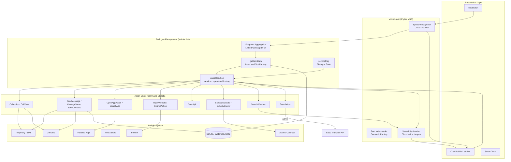
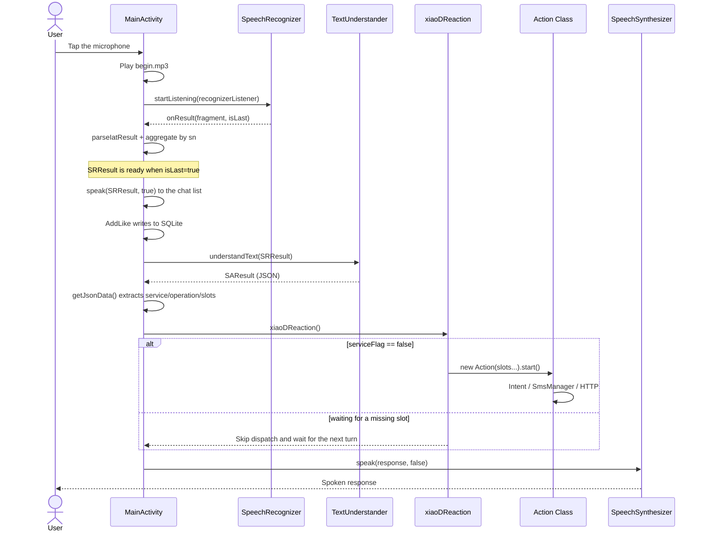
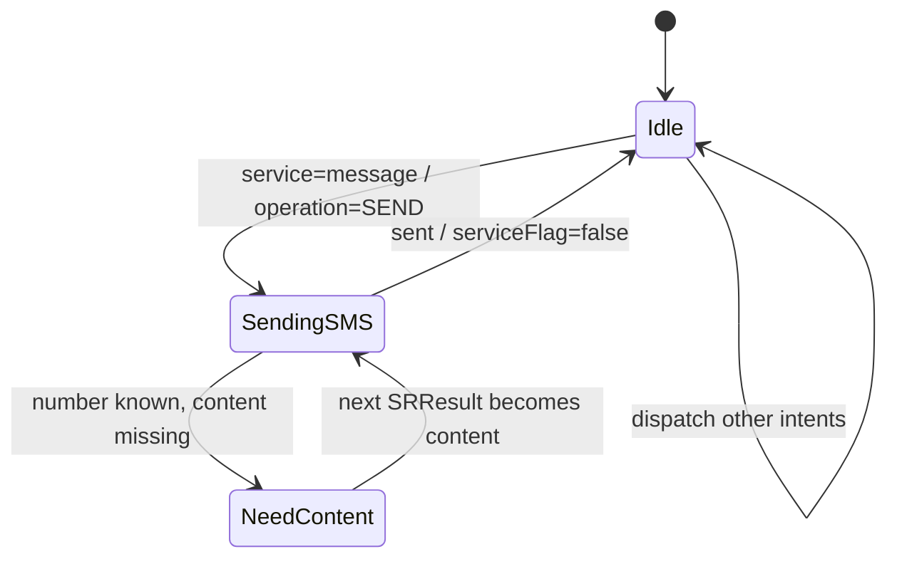

# DDvoice (Xiao D)

An Android Chinese voice assistant in the spirit of Siri: tap the microphone, speak, and the app runs a complete loop of **speech recognition → semantic understanding → intent routing → system action → spoken response**.

This is a native Android project from the Eclipse ADT era (`minSdkVersion 8` / `targetSdkVersion 20`, no Gradle). Speech recognition, semantic understanding, and speech synthesis all rely on the **iFlytek MSC SDK**, while translation uses the **Baidu Translate open API**. There is no backend: the app is an on-device orchestrator that maps cloud speech and NLU capabilities onto real phone actions.

> This README is derived from the repository source. It covers the technical architecture, core design logic, intent coverage, known issues, and future directions.

> Chinese version: [README.zh-CN.md](README.zh-CN.md)

---

## Table of Contents

- [Feature Overview](#feature-overview)
- [Tech Stack](#tech-stack)
- [Architecture](#architecture)
- [End-to-End Conversation Flow](#end-to-end-conversation-flow)
- [Core Design](#core-design)
  - [1. Three-Stage Voice Pipeline: ASR → NLU → TTS](#1-three-stage-voice-pipeline-asr--nlu--tts)
  - [2. Two-Level Intent Routing: service × operation](#2-two-level-intent-routing-service--operation)
  - [3. Slot Extraction and Global Context](#3-slot-extraction-and-global-context)
  - [4. Dialogue State and Multi-Turn Slot Filling](#4-dialogue-state-and-multi-turn-slot-filling)
  - [5. Action Layer: Turning Semantics into System Calls](#5-action-layer-turning-semantics-into-system-calls)
  - [6. Fuzzy Contact Matching](#6-fuzzy-contact-matching)
  - [7. Interaction Log and Like Data](#7-interaction-log-and-like-data)
  - [8. Adding a New Service](#8-adding-a-new-service)
- [Project Layout](#project-layout)
- [Build and Run](#build-and-run)
- [Known Issues and Limitations](#known-issues-and-limitations)
- [Future Directions](#future-directions)
- [Design Documents in the Repository](#design-documents-in-the-repository)

---

## Feature Overview

| Scenario | Example utterance | Implementation |
| --- | --- | --- |
| Make a call | "Call Zhang San" | Contact lookup → `ACTION_CALL` |
| View call history | "Open recent calls" | `ACTION_CALL_BUTTON` |
| Send an SMS | "Text Zhang San: see you tomorrow" | `SmsManager` + write to the system Sent box |
| View messages | "Open messages" | Jump to the system conversation list |
| Send a contact card | "Send Zhang San to Li Si" | Resolve both contacts, then send an SMS |
| Launch an app | "Open WeChat" | Enumerate launcher activities via `PackageManager` |
| Search an app store | "Search WeChat" | `market://search?q=` |
| Open a site / search | "Open Baidu" / "Search the weather" | System browser + Baidu mobile search |
| Chit-chat / encyclopedia / Q&A | "Who are you?" | Speak the `answer.text` returned by iFlytek |
| Set an alarm / event | "Set an alarm" | `AlarmClock` / `CalendarContract` insert UI |
| Check the weather | "What's the weather in Beijing?" | Speak the 6-day weather array from iFlytek |
| Translate | "Translate hello into English" | Baidu Translate HTTP API on a worker thread |

---

## Tech Stack

| Layer | Choice |
| --- | --- |
| Platform | Android (Java), Eclipse ADT project, `target=android-20` |
| UI | Single `Activity` + `ListView` + custom `BaseAdapter` (chat bubbles) |
| Speech recognition | iFlytek `SpeechRecognizer` (cloud dictation, Mandarin) |
| Semantic understanding | iFlytek `TextUnderstander` (`DOMAIN=iat`) |
| Speech synthesis | iFlytek `SpeechSynthesizer` (cloud voice `xiaoyan`) |
| Translation | Baidu Translate open API `openapi.baidu.com/public/2.0/bmt/translate` |
| Local storage | `SQLiteOpenHelper` (`DDvoice.db` / `Like` table) |
| System APIs | `Intent`, `SmsManager`, `ContactsContract`, `PackageManager`, `MediaStore`, `AlarmClock`, `CalendarContract` |
| Dependencies | `libs/Msc.jar`, `libs/armeabi/libmsc.so`, `appcompat_v7` |

**There is no server-side code.** Speech and semantics are handled entirely in the iFlytek cloud; the app only configures parameters, parses results, maintains state, and dispatches actions.

---

## Architecture



Layered responsibilities:

- **Presentation layer**: a single `MainActivity` that owns the full-screen chat UI, the voice button, and message appending.
- **Voice layer**: the three iFlytek objects (dictation, semantics, synthesis) are initialized together in `speechRecognition()`.
- **Dialogue management**: `getJsonData()` + `xiaoDReaction()` inside `MainActivity` form the "brain" of the system.
- **Action layer**: one class per service. Slots and the `Activity` are injected via the constructor; `start()` performs the concrete action.

---

## End-to-End Conversation Flow



A key detail: **recognition results arrive as streamed fragments**. The code stores each fragment in a `LinkedHashMap` keyed by `sn` and concatenates them in insertion order, triggering semantic understanding only when `isLast` is true. The NLU callback switches back to the main thread with `runOnUiThread`, then parses and routes synchronously.

---

## Core Design

### 1. Three-Stage Voice Pipeline: ASR → NLU → TTS

All three iFlytek objects share one `SpeechUtility` instance (initialized with the AppID):

| Stage | Object | Key parameters | Output |
| --- | --- | --- | --- |
| Dictation | `SpeechRecognizer` | `ENGINE_TYPE=cloud`, `LANGUAGE=zh_cn`, `RESULT_TYPE=json`, `VAD_BOS=4000`, `VAD_EOS=1000`, `ASR_PTT=1` | Fragmented JSON; each word is `ws[].cw[0].w` |
| Semantics | `TextUnderstander` | `DOMAIN=iat` | Structured JSON (service / operation / slots) |
| Synthesis | `SpeechSynthesizer` | `ENGINE_TYPE=cloud`, `VOICE_NAME=xiaoyan` | Direct playback |

The trade-off is explicit: **no in-house ASR/NLU and no on-device model**. Around 2015, iFlytek's combined dictation + semantic API could directly return "service name + operation name + slots", which let a client app cover more than a dozen domains without training a model. The cost is a hard dependency on the cloud, an AppID requirement, and no offline mode.

`JsonParser.parseIatResult()` takes only the first candidate of each word (`cw[0]`); the multi-candidate capability is retained as commented code.

### 2. Two-Level Intent Routing: service × operation

The iFlytek semantic result is abstracted into two levels:

- `service`: the domain, such as `telephone`, `message`, or `weather`;
- `operation`: the action within that domain, such as `CALL`, `SEND`, or `QUERY`.

`xiaoDReaction()` dispatches with two nested `switch` statements. The `default` branch always replies: "I don't know what you want to do, but I think I'll understand someday."

| service | operation | Main slots | Action class | Implementation |
| --- | --- | --- | --- | --- |
| `telephone` | `CALL` | `name` / `code` | `CallAction` | Contact lookup, then `ACTION_CALL` |
| `telephone` | `VIEW` | — | `CallView` | `ACTION_CALL_BUTTON` |
| `message` | `SEND` | `name` / `code` / `content` | `SendMessage` | `SmsManager` + write to Sent |
| `message` | `VIEW` | — | `MessageView` | Launch `com.android.mms` |
| `message` | `SENDCONTACTS` | `name` / `receiver` | `SendContacts` | Resolve two numbers and send an SMS |
| `app` | `LAUNCH` | `name` | `OpenAppAction` | `queryIntentActivities` |
| `app` | `QUERY` | `name` / `price` | `SearchApp` | `market://search` |
| `website` | `OPEN` | `url` / `name` | `OpenWebsite` | System browser; Baidu search when URL is missing |
| `websearch` | `QUERY` | `keywords` | `SearchAction` | Baidu mobile search |
| `faq` / `chat` / `openQA` / `baike` | `ANSWER` | `text` | `OpenQA` | Speak `answer.text` directly |
| `schedule` | `CREATE` | `name` / `time` / `date` / `content` | `ScheduleCreate` | Alarm / calendar insert screen |
| `schedule` | `VIEW` | `name` | `ScheduleView` | Same as above (view is not really implemented) |
| `weather` | `QUERY` | `city` + `data.result[]` | `SearchWeather` | Speak 6 days of weather |
| `translation` | `TRANSLATION` | `content` / `source` / `target` | `Translation` | Baidu Translate over HTTP |

The advantage is **cheap extension**: to add a domain, configure the matching `service/operation` in the semantic platform, add one `case` to the router, and write an Action class. The downside is that routing is hard-coded inside `MainActivity`, so the class grows with every service (currently 12 services and 18 operations).

### 3. Slot Extraction and Global Context

`getJsonData()` unpacks SAResult into a set of **static fields** that action classes read directly:

```java
operation = json.optString("operation");
service   = json.optString("service");
slots     = json.optJSONObject("semantic").optJSONObject("slots");

receiver = slots.optString("receiver");
name     = slots.optString("name");
code     = slots.optString("code");      // phone number
content  = slots.optString("content");   // SMS body / text to translate
keywords = slots.optString("keywords");
url      = slots.optString("url");
song     = slots.optString("song");
city     = slots.optJSONObject("location").optString("city");
target   = slots.optString("target");    // translation target language
source   = slots.optString("source");    // translation source language
```

Every field is `public static`, effectively an **implicit global dialogue context**. It simplifies action construction (no parameter threading), but it also introduces concurrency and state-leak problems (see "Known Issues").

Weather is the only intent that consumes the `data.result` array: it reads `result[1]` through `result[6]` (six days) and expands seven dimensions — `date / weather / tempRange / airQuality / wind / humidity / windLevel` — which `SearchWeather` announces day by day.

### 4. Dialogue State and Multi-Turn Slot Filling

The system has exactly one explicit dialogue state flag:

```java
public static boolean serviceFlag = false;   // whether the app is inside a service
private int mainServiceID = 0;               // main-service context (reserved)
private int branchServiceID = 0;             // branch-service context (reserved)
```

`xiaoDReaction()` only dispatches intents when `serviceFlag == false`. When it is `true`, dispatch is skipped, meaning "the current turn is filling a slot left over from the previous turn."

In practice, only one path uses multi-turn slot filling: **sending an SMS without a body**:

```java
if (content is empty) {
    serviceFlag = true;
    speak("What would you like to send?", false);

    new Thread(() -> {
        while (SRResult == null || SRResult.equals("")) {
            // busy-wait for the next recognition result
        }
        mcontent = SRResult;
        smsManager.sendTextMessage(number, null, mcontent, ...);
        insertDB(number, mcontent);
        serviceFlag = false;
    }).start();
}
```

The intent is: **when a required slot is missing, ask for it proactively, then fill it directly from the next recognition result.** This is a minimal slot-filling state machine:



The fields `mainServiceID` / `branchServiceID` and a commented-out `dialogueManagement()` show that the author intended to extend this into a **two-level main/branch service context** (for example, splitting "phone" into "dial" and "call history"), but it was never wired up.

### 5. Action Layer: Turning Semantics into System Calls

Every Action class is a **command object**: constructor arguments are slots, `start()` is the execution entry point. Common implementations:

- **Phone**: `Intent.ACTION_CALL` with `tel:`; when the slot is empty, it degrades to `ACTION_DIAL` to open the dialer.
- **SMS**: `SmsManager.sendTextMessage()`; messages over 70 characters are split with `divideMessage()`; after sending, a record is inserted into `content://sms/sent` so it appears in the system messaging UI.
- **Apps**: `PackageManager.queryIntentActivities()` enumerates all launcher entries, then uses `label.contains(slotName)` for substring matching; Contacts is special-cased.
- **Web/search**: `ACTION_VIEW` with `http://m.baidu.com/s?word=`; the code explicitly targets `com.android.browser`, which reliably resolved to the system browser at the time.
- **Alarm/calendar**: `AlarmClock.ACTION_SET_ALARM` and `CalendarContract.Events.CONTENT_URI` insert screens; they only navigate and do not prefill time or content.
- **Media**: `MediaStore` query + `ACTION_VIEW` (`PlayAction` is implemented but not routed).
- **Translation**: `HttpPost` (`DefaultHttpClient`) on a worker thread, then back to the main thread via `Handler`; language codes are mapped as `ja→jp`, `ko→kor`, `es→spa`, `fr→fra`.

### 6. Fuzzy Contact Matching

`CallAction`, `SendMessage`, and `SendContacts` each contain their own copy of `getNumberByName()`:

1. Query `ContactsContract.Contacts.CONTENT_FILTER_URI` with the name for prefix/fuzzy filtering.
2. Take the `_ID` of the **first** match.
3. Query `CommonDataKinds.Phone.CONTENT_URI` for that contact and take the first phone number.

So "find Liu" resolves to the first person surnamed Liu in the address book instead of asking the user to confirm. This is exactly the TODO in `待改进的点&也是亮点.txt`: show all matching contacts and let the user choose.

### 7. Interaction Log and Like Data

`AddLike` runs after every recognition (`isLast`):

```java
values.put("reaction", SRResult);  // the user's utterance
values.put("like", 1);
helper.insert(values);
```

Records go into the `Like` table (`_id / reaction / like`) in `DDvoice.db`. The design goal, per `待改进的点&也是亮点.txt`, is to **let users like or dislike every answer and use the statistics to improve weak responses**. The current implementation only logs the utterance automatically with `like=1`; there is no dislike entry point, and `QueryActivity` is an empty shell (its query/delete code is fully commented out), so the feedback loop is not actually closed.

### 8. Adding a New Service

1. Configure a new `service` / `operation` and its slots on the iFlytek semantic platform.
2. Parse any new slots in `getJsonData()` (skip if existing fields suffice).
3. Add a branch under `switch(service)` in `xiaoDReaction()`.
4. Create an Action class, inject slots and the `Activity` via its constructor, and implement `start()`.
5. Add any new permissions to `AndroidManifest.xml`.

---

## Project Layout

```text
DDvoice/
├── AndroidManifest.xml          # Permissions, MainActivity, leftover SemanticAnalysis declaration
├── project.properties           # target=android-20, depends on ../appcompat_v7
├── libs/
│   ├── Msc.jar                  # iFlytek MSC SDK
│   ├── armeabi/libmsc.so        # iFlytek native library
│   └── android-support-v4.jar
├── src/com/example/ddvoice/
│   ├── MainActivity.java        # Voice pipeline + NLU parsing + routing + UI (~1,070 lines)
│   ├── JsonParser.java          # Dictation fragment JSON parsing
│   ├── DBHelper.java            # SQLite (Like table)
│   ├── AddLike.java             # Writes interaction records
│   ├── QueryActivity.java       # Record browser (empty implementation)
│   ├── ChatMsgViewAdapter.java  # Chat bubble adapter
│   ├── CallAction.java          # Place a call
│   ├── CallView.java            # Call history
│   ├── SendMessage.java         # Send SMS (includes slot filling)
│   ├── SendContacts.java        # Send a contact card
│   ├── MessageView.java         # Message list
│   ├── OpenAppAction.java       # Launch an app
│   ├── SearchApp.java           # App store search
│   ├── OpenWebsite.java         # Open a URL
│   ├── SearchAction.java        # Web search
│   ├── OpenQA.java              # Speak a Q&A answer
│   ├── ScheduleCreate.java      # Create alarm/event
│   ├── ScheduleView.java        # View alarm/event
│   ├── SearchWeather.java       # Weather announcement
│   ├── Translation.java         # Translation
│   ├── Utils.java               # Baidu Translate HTTP wrapper
│   ├── GetLocation.java         # Location (not wired in)
│   ├── PlayAction.java          # Music/video playback (not wired in)
│   └── util/SystemUiHider*.java # Fullscreen UI helpers
├── res/
│   ├── layout/main.xml          # Chat list + bottom mic button
│   ├── layout/list_item.xml     # Single chat bubble
│   ├── drawable/                # Bubbles, mic, Siri button
│   └── raw/begin.mp3, lock.mp3  # Start/end sound effects
├── bin/DDvoice.apk              # Prebuilt APK (historical artifact)
├── Policy Learning ... .pdf     # Paper on multi-domain dialogue policy
├── 存在的问题.txt
├── 待改进的点&也是亮点.txt
└── 文献翻译.txt
```

---

## Build and Run

### Prerequisites

- Android SDK (`android-20`)
- Eclipse ADT, or another IDE capable of importing an Eclipse project
- A valid iFlytek Open Platform AppID
- A Baidu Translate API key (optional; only translation needs it)

### Steps

1. **Fix the dependency path.** `project.properties` contains `android.library.reference.1=../appcompat_v7`. An `appcompat_v7` project must exist as a sibling directory, or the path must be adjusted.
2. **Configure the iFlytek AppID** in `MainActivity.initIflytek()`:

   ```java
   SpeechUtility.createUtility(this, SpeechConstant.APPID + "=553f8bf7");
   ```

   Replace `553f8bf7` with your own AppID. Do not use the repository default for commercial purposes.

3. **Configure the translation key.** Replace `API_KEY` in `Utils.java` with your own Baidu Translate `client_id`.
4. **Handle source encoding.** Files under `src/` and some text files are encoded in **GBK/GB18030**. They will look garbled when opened as UTF-8; convert them or set the IDE encoding to GBK before importing.
5. **Build and run.** In Eclipse, use `Run As → Android Application`. The repository also ships a historical build artifact at `bin/DDvoice.apk`, which can be installed directly on an older Android device.

### Permissions

The app requests: network and network state, audio recording, phone state, contacts read, calling, SMS send/receive/write, fine location, and set-alarm. All are granted at install time (target SDK 20, predating the Android 6.0 runtime permission model).

---

## Known Issues and Limitations

All of the following map directly to the source and are important context for understanding the project:

| Area | Issue |
| --- | --- |
| Secret management | The iFlytek AppID and Baidu Translate key are hard-coded in source and publicly visible |
| Architecture | `MainActivity` is about 1,070 lines and combines UI, ASR, NLU, routing, and TTS — a classic god class |
| State management | Slots and `serviceFlag` are mutable `static` fields; `SRResult`/`SAResult` are nulled at the start of `xiaoDReaction()`, racing with the slot-filling thread |
| Multi-turn dialogue | Slot filling uses a **busy-wait thread** polling `SRResult`, with no timeout, cancellation, or re-prompt; anything the user says becomes the SMS body; state is lost on process restart |
| Multi-turn coverage | Only "SMS missing body" has a slot-filling path; a missing number for a call or a missing recipient for an SMS is never requested |
| Business logic | `SendMessage` only works when the number is empty and a name is present; if the NLU result supplies a number directly, no message is sent |
| Weather | The city depends on an iFlytek semantic slot; `GetLocation` is not wired in (`LocationToCity()` is a placeholder returning the provider), so local weather is unavailable; the code always reads six days starting at index 1 |
| Dead code | `PlayAction` (music/video) is implemented but commented out in routing; `QueryActivity` is empty; `GetLocation` is commented out |
| Manifest leftover | `AndroidManifest.xml` declares a `SemanticAnalysis` Activity that does not exist in the source, with the action name `android.intent.action.0` |
| Inconsistent speech | `OpenAppAction` and `PlayAction` call `speak(msg, true)`; when the flag is `true`, the text is only rendered and not spoken, so some actions give no voice feedback |
| Recognition state | `mIatResults` is initialized once per process and never cleared between sessions; reused fragment `sn` values can leave trailing text from a previous turn |
| Compatibility | `minSdk 8` / `target 20`; uses `DefaultHttpClient`, `Environment.getExternalStorageDirectory()`, an explicit `com.android.browser` component, no runtime permission handling, and cleartext HTTP |
| Engineering | No Gradle, CI, or tests; sources are GBK; compiled artifacts and `classes.dex` are committed under `bin/` |
| Feedback loop | The Like table is write-only, `like` is always 1, and there is no dislike entry point or statistics screen |

---

## Future Directions

`待改进的点&也是亮点.txt`, `文献翻译.txt`, and the paper *Policy Learning for Domain Selection in an Extensible Multi-domain Spoken Dialogue System* lay out the intended evolution:

1. **Hierarchical multi-domain architecture**: one "domain expert" per domain, coordinated by a central controller that identifies the domain, judges whether a request is out of scope, and asks the user whether to switch domains.
2. **GPTD policy learning**: learn the central controller's domain-selection policy with Gaussian Process Temporal Difference, so **new domains can be added without retraining the controller**.
3. **Contact disambiguation**: show candidates when multiple contacts match instead of silently taking the first.
4. **A complete dialogue state machine**: use `mainServiceID` / `branchServiceID` to model main/branch context and make enter, clarify, switch, and exit transitions explicit.
5. **Memory system**: long-term memory as key-value pairs (user preferences), short-term memory as "what just happened".
6. **Emotion / proactive reminders**: set thresholds for repeated behaviors and proactively suggest alternatives, storing thresholds in long-term memory.
7. **Feedback loop**: let users like or dislike every answer, then use the low-scoring responses for iteration.

---

## Design Documents in the Repository

| File | Content |
| --- | --- |
| `存在的问题.txt` | Known issue: weather requires the local geographic location |
| `待改进的点&也是亮点.txt` | Contact disambiguation, service status codes, memory system, emotion system, like/dislike |
| `文献翻译.txt` | Translated notes on domain experts, the central controller, and GPTD |
| `Policy Learning for Domain Selection ... .pdf` | Original paper on domain-selection policy learning |

---

## License

No open-source license is declared in this repository. Contact the author before reusing the code.
