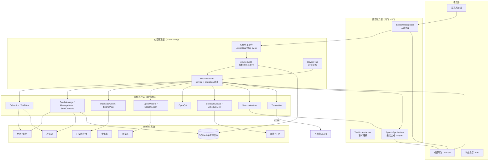
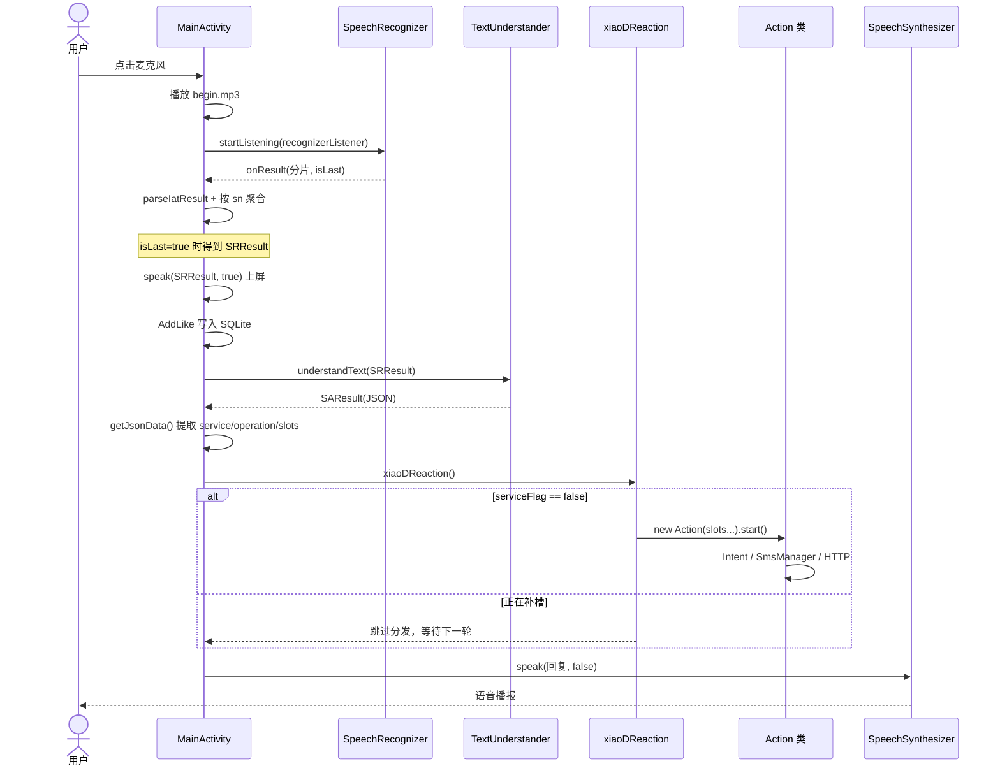
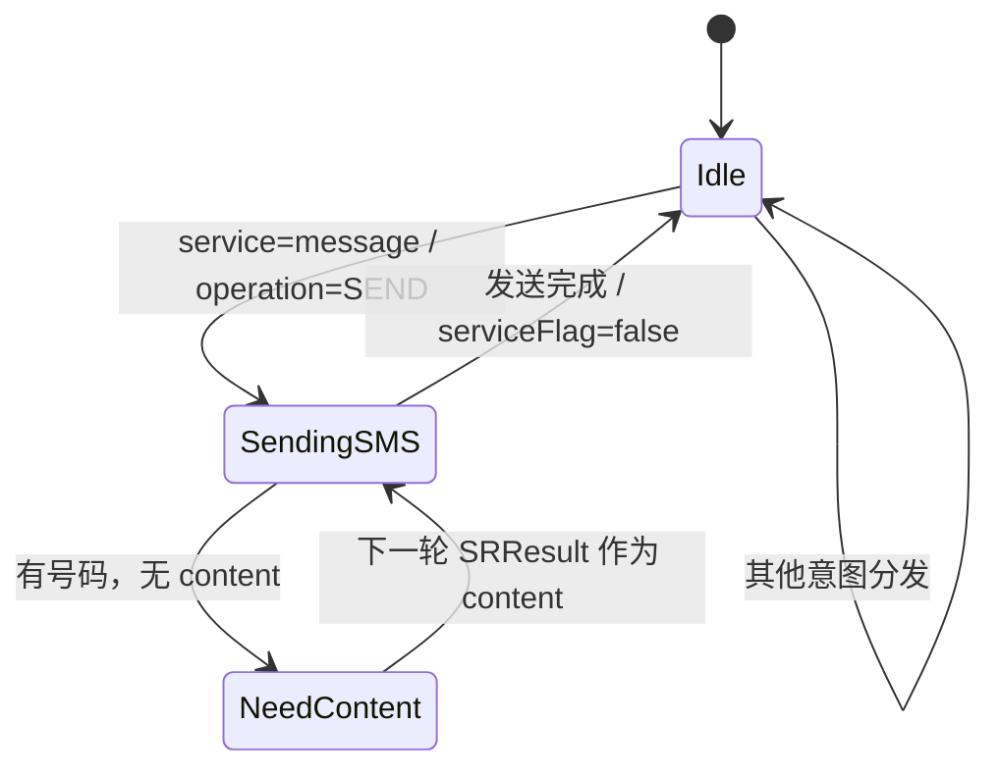

# DDvoice（小D）

一个仿 Siri 的中文智能语音助手 Android 应用：点一下麦克风说话，应用完成**语音识别 → 语义理解 → 意图路由 → 调用系统能力 → 语音播报**的完整闭环。

项目是 Eclipse ADT 时代的原生 Android 工程（`minSdkVersion 8` / `targetSdkVersion 20`，无 Gradle），语音识别、语义理解和语音合成都依赖**科大讯飞 MSC SDK**，翻译调用**百度翻译开放接口**。应用本身不设后端，定位是一个"端侧编排器"：把云端的语音/语义能力映射为手机上的真实动作。

> 本 README 依据仓库源码整理，包含技术架构、核心设计逻辑、意图清单、已知问题与后续方向。

---

## 目录

- [功能概览](#功能概览)
- [技术栈](#技术栈)
- [整体架构](#整体架构)
- [一次对话的完整时序](#一次对话的完整时序)
- [核心技术设计](#核心技术设计)
  - [1. 三级语音链路：ASR → NLU → TTS](#1-三级语音链路asr--nlu--tts)
  - [2. service × operation 二级意图路由](#2-service--operation-二级意图路由)
  - [3. 槽位抽取与全局上下文](#3-槽位抽取与全局上下文)
  - [4. 对话状态与多轮补槽](#4-对话状态与多轮补槽)
  - [5. 动作执行层：把语义变成系统调用](#5-动作执行层把语义变成系统调用)
  - [6. 通讯录模糊匹配](#6-通讯录模糊匹配)
  - [7. 交互日志与点赞数据](#7-交互日志与点赞数据)
  - [8. 如何新增一个服务](#如何新增一个服务)
- [工程结构](#工程结构)
- [编译与运行](#编译与运行)
- [已知问题与限制](#已知问题与限制)
- [后续方向](#后续方向)
- [仓库内的设计资料](#仓库内的设计资料)

---

## 功能概览

| 场景 | 示例说法 | 实现 |
| --- | --- | --- |
| 打电话 | "给张三打电话" | 查通讯录 → `ACTION_CALL` |
| 查看通话记录 | "打开最近通话" | `ACTION_CALL_BUTTON` |
| 发短信 | "给张三发短信，内容是明天见" | `SmsManager` + 写入系统已发送箱 |
| 查看短信 | "打开短信" | 跳转系统短信会话列表 |
| 发名片 | "把张三发给李四" | 通讯录查两个号码后发短信 |
| 打开应用 | "打开微信" | `PackageManager` 遍历桌面 Activity |
| 应用市场搜索 | "搜索微信" | `market://search?q=` |
| 打开网站 / 搜索 | "打开百度" / "搜索天气" | 系统浏览器 + 百度移动搜索 |
| 闲聊 / 百科 / 问答 | "你是谁" | 直接播报讯飞返回的 `answer.text` |
| 建闹钟 / 日程 | "定个闹钟" | `AlarmClock` / `CalendarContract` 插入界面 |
| 查天气 | "北京天气怎么样" | 播报讯飞返回的 6 天天气数组 |
| 翻译 | "把你好翻译成英文" | 百度翻译 HTTP API，子线程请求 |

---

## 技术栈

| 层 | 选型 |
| --- | --- |
| 平台 | Android（Java），Eclipse ADT 工程，`target=android-20` |
| UI | 单 `Activity` + `ListView` + 自定义 `BaseAdapter`（气泡式对话） |
| 语音识别 | 科大讯飞 `SpeechRecognizer`（云端听写，中文普通话） |
| 语义理解 | 科大讯飞 `TextUnderstander`（`DOMAIN=iat`） |
| 语音合成 | 科大讯飞 `SpeechSynthesizer`（云端发音人 `xiaoyan`） |
| 翻译 | 百度翻译开放接口 `openapi.baidu.com/public/2.0/bmt/translate` |
| 本地存储 | `SQLiteOpenHelper`（`DDvoice.db` / `Like` 表） |
| 系统能力 | `Intent`、`SmsManager`、`ContactsContract`、`PackageManager`、`MediaStore`、`AlarmClock`、`CalendarContract` |
| 依赖 | `libs/Msc.jar`、`libs/armeabi/libmsc.so`、`appcompat_v7` |

**没有服务端代码。** 语音与语义全部在讯飞云端完成，应用只负责参数配置、结果解析、状态维护和动作分发。

---

## 整体架构



分层职责：

- **表现层**：只有一个 `MainActivity`，负责全屏对话界面、语音按钮和消息追加。
- **语音能力层**：讯飞 SDK 的三个对象（听写、语义、合成）在 `speechRecognition()` 中一次性初始化。
- **对话管理层**：`MainActivity` 内的 `getJsonData()` + `xiaoDReaction()`，是整个系统的"大脑"。
- **动作执行层**：每个服务一个类，构造时注入槽位与 `Activity`，`start()` 执行具体动作。

---

## 一次对话的完整时序



关键点：**识别结果是流式分片返回的**，代码用 `sn` 作为 key 存入 `LinkedHashMap` 再按插入顺序拼接，`isLast` 为真时才触发语义理解。语义理解回调通过 `runOnUiThread` 切回主线程，然后同步执行解析与路由。

---

## 核心技术设计

### 1. 三级语音链路：ASR → NLU → TTS

三个讯飞对象共享同一个 `SpeechUtility`（AppID 初始化）：

| 环节 | 对象 | 关键参数 | 结果形态 |
| --- | --- | --- | --- |
| 听写 | `SpeechRecognizer` | `ENGINE_TYPE=cloud`、`LANGUAGE=zh_cn`、`RESULT_TYPE=json`、`VAD_BOS=4000`、`VAD_EOS=1000`、`ASR_PTT=1` | 分片 JSON，`ws[].cw[0].w` 为词 |
| 语义 | `TextUnderstander` | `DOMAIN=iat` | 结构化 JSON（service / operation / slots） |
| 合成 | `SpeechSynthesizer` | `ENGINE_TYPE=cloud`、`VOICE_NAME=xiaoyan` | 直接播放 |

设计上的取舍很明确：**不自研 ASR/NLU，也不做本地模型**。讯飞在 2015 年前后提供的"听写 + 语义"一体化接口，可以直接输出"服务名 + 操作名 + 槽位"，这让一个客户端应用无需训练模型就能覆盖十多个领域。代价是强依赖云端、需要 AppID、离线不可用。

`JsonParser.parseIatResult()` 只取每个词的第一个候选（`cw[0]`），多候选能力被注释保留。

### 2. service × operation 二级意图路由

讯飞的语义结果被抽象成两级：

- `service`：领域，如 `telephone`、`message`、`weather`；
- `operation`：领域内的动作，如 `CALL`、`SEND`、`QUERY`。

`xiaoDReaction()` 用两层 `switch` 完成分发，`default` 分支统一回复"不知道您要干嘛，不过我想过一段时间我就会懂了。"

| service | operation | 主要槽位 | 动作类 | 落地方式 |
| --- | --- | --- | --- | --- |
| `telephone` | `CALL` | `name` / `code` | `CallAction` | 查通讯录后 `ACTION_CALL` |
| `telephone` | `VIEW` | — | `CallView` | `ACTION_CALL_BUTTON` |
| `message` | `SEND` | `name` / `code` / `content` | `SendMessage` | `SmsManager` + 写已发送箱 |
| `message` | `VIEW` | — | `MessageView` | 跳转 `com.android.mms` |
| `message` | `SENDCONTACTS` | `name` / `receiver` | `SendContacts` | 两个号码互发短信 |
| `app` | `LAUNCH` | `name` | `OpenAppAction` | `queryIntentActivities` |
| `app` | `QUERY` | `name` / `price` | `SearchApp` | `market://search` |
| `website` | `OPEN` | `url` / `name` | `OpenWebsite` | 系统浏览器；无 URL 时百度搜索 |
| `websearch` | `QUERY` | `keywords` | `SearchAction` | 百度移动搜索 |
| `faq` / `chat` / `openQA` / `baike` | `ANSWER` | `text` | `OpenQA` | 直接播报 `answer.text` |
| `schedule` | `CREATE` | `name` / `time` / `date` / `content` | `ScheduleCreate` | 闹钟 / 日历插入页 |
| `schedule` | `VIEW` | `name` | `ScheduleView` | 同上（查看未真正实现） |
| `weather` | `QUERY` | `city` + `data.result[]` | `SearchWeather` | 播报 6 天天气 |
| `translation` | `TRANSLATION` | `content` / `source` / `target` | `Translation` | 百度翻译 HTTP |

这种设计的优点是**扩展成本低**：新增一个领域，只需要在语义平台配置对应的 `service/operation`，再在路由里加一个 `case` 和一个 Action 类。缺点是路由逻辑硬编码在 `MainActivity` 里，服务一多就会膨胀（当前已 12 个服务、18 个操作）。

### 3. 槽位抽取与全局上下文

`getJsonData()` 把 SAResult 拆成一组**静态字段**，供后续动作类直接读取：

```java
operation = json.optString("operation");
service   = json.optString("service");
slots     = json.optJSONObject("semantic").optJSONObject("slots");

receiver = slots.optString("receiver");
name     = slots.optString("name");
code     = slots.optString("code");      // 电话号码
content  = slots.optString("content");   // 短信内容 / 翻译文本
keywords = slots.optString("keywords");
url      = slots.optString("url");
song     = slots.optString("song");
city     = slots.optJSONObject("location").optString("city");
target   = slots.optString("target");    // 翻译目标语言
source   = slots.optString("source");    // 翻译源语言
```

所有字段都是 `public static`，相当于一个**隐式的全局对话上下文**。它简化了 Action 类的构造（不用层层传参），但也带来并发与状态污染问题（见"已知问题"）。

天气是唯一使用 `data.result` 数组的意图：取 `result[1]` 到 `result[6]`（共 6 天），展开 `date / weather / tempRange / airQuality / wind / humidity / windLevel` 七个维度，由 `SearchWeather` 逐日播报。

### 4. 对话状态与多轮补槽

系统只有一个明确的对话状态位：

```java
public static boolean serviceFlag = false;   // 是否正在某项服务中
private int mainServiceID = 0;               // 主服务上下文（预留）
private int branchServiceID = 0;             // 分支服务上下文（预留）
```

`xiaoDReaction()` 仅在 `serviceFlag == false` 时做意图分发；为 `true` 时跳过，表示"当前轮输入用于补齐上一轮缺失的槽位"。

目前真正用上多轮补槽的只有**发短信缺内容**这一条路径：

```java
if (content 为空) {
    serviceFlag = true;
    speak("你要发送什么内容呢？", false);

    new Thread(() -> {
        while (SRResult == null || SRResult.equals("")) {
            // 忙等下一轮识别结果
        }
        mcontent = SRResult;
        smsManager.sendTextMessage(number, null, mcontent, ...);
        insertDB(number, mcontent);
        serviceFlag = false;
    }).start();
}
```

设计意图是"**必要条件未满足时主动追问，下一次识别结果直接填入槽位**"，即一个最小化的槽填充（slot filling）状态机：



`mainServiceID` / `branchServiceID` 以及一段被注释的 `dialogueManagement()` 说明作者原本想把它扩展成**主服务/分支服务两级上下文**（例如"打电话"下区分"拨号"和"查记录"），但最终没有接入。

### 5. 动作执行层：把语义变成系统调用

每个 Action 类都是一个**命令对象**：构造参数是槽位，`start()` 是执行入口。常见的落地方式：

- **电话**：`Intent.ACTION_CALL` + `tel:`；槽位为空时退化为 `ACTION_DIAL` 打开拨号盘。
- **短信**：`SmsManager.sendTextMessage()`；超过 70 字用 `divideMessage()` 分条；发送后把记录插入 `content://sms/sent`，让系统短信界面能看到。
- **应用**：`PackageManager.queryIntentActivities()` 拿到所有桌面入口，用 `label.contains(槽位名)` 做包含匹配；通讯录做特殊处理。
- **网页/搜索**：`ACTION_VIEW` + `http://m.baidu.com/s?word=`；代码显式指定 `com.android.browser`，在当年可保证落在系统浏览器。
- **闹钟/日程**：`AlarmClock.ACTION_SET_ALARM`、`CalendarContract.Events.CONTENT_URI` 插入页；只负责跳转，不预填时间/内容。
- **媒体**：`MediaStore` 查询 + `ACTION_VIEW`（`PlayAction` 已实现但未接入路由）。
- **翻译**：子线程 `HttpPost`（`DefaultHttpClient`），`Handler` 回主线程播报；语言码做了 `ja→jp`、`ko→kor`、`es→spa`、`fr→fra` 的映射。

### 6. 通讯录模糊匹配

`CallAction`、`SendMessage`、`SendContacts` 各自复制了一份 `getNumberByName()`：

1. 用 `ContactsContract.Contacts.CONTENT_FILTER_URI` 按名字做前缀/模糊过滤；
2. 取**第一条**命中的 `_ID`；
3. 再查 `CommonDataKinds.Phone.CONTENT_URI` 取第一个号码。

因此"找刘同学"会命中通讯录里第一个姓刘的人，而不是让用户确认——这正是仓库 `待改进的点&也是亮点.txt` 中提到的待办：把联系人候选全部展示出来供选择。

### 7. 交互日志与点赞数据

每次识别结束（`isLast`）都会执行 `AddLike`：

```java
values.put("reaction", SRResult);  // 用户原话
values.put("like", 1);
helper.insert(values);
```

写入 `DDvoice.db` 的 `Like` 表（`_id / reaction / like`）。设计目标见 `待改进的点&也是亮点.txt`：**对每个回答点赞/点踩，统计哪些回答需要改进**。当前实现只是自动记录用户语句并固定 `like=1`，还没有 UI 触发点踩，`QueryActivity` 也是空壳（查询/删除代码被整体注释），所以"数据闭环"尚未真正形成。

### 8. 如何新增一个服务

1. 在讯飞语义平台配置新的 `service` / `operation` 与槽位；
2. 在 `getJsonData()` 中补充需要的槽位解析（若沿用现有字段可跳过）；
3. 在 `xiaoDReaction()` 的 `switch(service)` 下新增分支；
4. 新建 Action 类，构造注入槽位与 `Activity`，实现 `start()`；
5. 在 `AndroidManifest.xml` 补权限（如新的系统能力）。

---

## 工程结构

```text
DDvoice/
├── AndroidManifest.xml          # 权限、MainActivity、遗留的 SemanticAnalysis 声明
├── project.properties           # target=android-20，依赖 ../appcompat_v7
├── libs/
│   ├── Msc.jar                  # 讯飞 MSC SDK
│   ├── armeabi/libmsc.so        # 讯飞 native 库
│   └── android-support-v4.jar
├── src/com/example/ddvoice/
│   ├── MainActivity.java        # 语音链路 + 语义解析 + 路由 + UI（约 1070 行）
│   ├── JsonParser.java          # 听写分片 JSON 解析
│   ├── DBHelper.java            # SQLite（Like 表）
│   ├── AddLike.java             # 写入交互记录
│   ├── QueryActivity.java       # 记录浏览（空实现）
│   ├── ChatMsgViewAdapter.java  # 对话气泡适配器
│   ├── CallAction.java          # 打电话
│   ├── CallView.java            # 通话记录
│   ├── SendMessage.java         # 发短信（含补槽逻辑）
│   ├── SendContacts.java        # 发名片
│   ├── MessageView.java         # 短信列表
│   ├── OpenAppAction.java       # 启动应用
│   ├── SearchApp.java           # 应用市场搜索
│   ├── OpenWebsite.java         # 打开网页
│   ├── SearchAction.java        # 网页搜索
│   ├── OpenQA.java              # 问答播报
│   ├── ScheduleCreate.java      # 建闹钟/日程
│   ├── ScheduleView.java        # 查看闹钟/日程
│   ├── SearchWeather.java       # 天气播报
│   ├── Translation.java         # 翻译
│   ├── Utils.java               # 百度翻译 HTTP 封装
│   ├── GetLocation.java         # 定位（未接入）
│   ├── PlayAction.java          # 音乐/视频播放（未接入）
│   └── util/SystemUiHider*.java # 全屏 UI 辅助
├── res/
│   ├── layout/main.xml          # 对话列表 + 底部麦克风
│   ├── layout/list_item.xml     # 单条气泡
│   ├── drawable/                # 气泡、麦克风、Siri 按钮
│   └── raw/begin.mp3, lock.mp3  # 开始/结束提示音
├── bin/DDvoice.apk              # 已编译 APK（历史产物）
├── Policy Learning ... .pdf     # 多领域对话策略论文
├── 存在的问题.txt
├── 待改进的点&也是亮点.txt
└── 文献翻译.txt
```

---

## 编译与运行

### 前置条件

- Android SDK（`android-20`）
- Eclipse ADT，或能导入 Eclipse 工程的其他 IDE
- 一个可用的讯飞开放平台 AppID
- 百度翻译 API Key（可选，仅翻译功能需要）

### 步骤

1. **修正依赖路径**：`project.properties` 中 `android.library.reference.1=../appcompat_v7`，需要同级目录存在 `appcompat_v7` 工程，或改为自己的路径。
2. **配置讯飞 AppID**：`MainActivity.initIflytek()` 中：

   ```java
   SpeechUtility.createUtility(this, SpeechConstant.APPID + "=553f8bf7");
   ```

   把 `553f8bf7` 换成自己的 AppID（仓库中的默认值请勿用于商业用途）。

3. **配置翻译 Key**：`Utils.java` 中的 `API_KEY` 同样需要替换为自己的百度翻译 `client_id`。
4. **处理源码编码**：`src/` 与部分文本文件是 **GBK/GB18030** 编码。用 UTF-8 打开会看到乱码，导入前请转码或在 IDE 中设置 GBK。
5. **构建运行**：Eclipse 中 `Run As → Android Application`；仓库也保留了历史构建产物 `bin/DDvoice.apk`，可直接安装到旧版 Android 设备体验。

### 权限

应用申请了：网络与网络状态、录音、读电话状态、读联系人、打电话、收发/写短信、精确定位、设置闹钟。均为安装时授予（目标 SDK 20，早于 Android 6.0 运行时权限模型）。

---

## 已知问题与限制

以下均可在源码中直接对应，属于"读懂这个项目"的重要背景：

| 类别 | 问题 |
| --- | --- |
| 密钥安全 | 讯飞 AppID、百度翻译 Key 硬编码在源码中，仓库公开可见 |
| 架构 | `MainActivity` 约 1070 行，集 UI、ASR、语义、路由、TTS 于一体，属于典型上帝类 |
| 状态管理 | 槽位与 `serviceFlag` 全是 `static` 可变字段；`SRResult`/`SAResult` 在 `xiaoDReaction()` 入口被置空，与补槽线程存在竞态 |
| 多轮对话 | 补槽用**忙等线程**轮询 `SRResult`，没有超时、取消、重问；用户说的任何话都会被当作短信内容；进程重启后状态丢失 |
| 多轮覆盖 | 只有"发短信缺内容"一条补槽路径；打电话缺号码、发短信缺收件人等都不会追问 |
| 识别状态 | `mIatResults` 在应用生命周期内只初始化一次，新会话不清空；分片 `sn` 复用可能残留上一轮的尾部文本 |
| 业务缺陷 | `SendMessage` 只在"号码为空、有姓名"时工作；语义直接给出号码时不会发送 |
| 天气 | 城市依赖讯飞语义槽；`GetLocation` 未接入（`LocationToCity()` 只是返回 provider 的占位实现），所以"本地天气"不可用；固定播报 6 天且从数组下标 1 开始 |
| 未接入代码 | `PlayAction`（音乐/视频）已实现但路由中被注释；`QueryActivity` 空实现；`GetLocation` 被注释 |
| 清单残留 | `AndroidManifest.xml` 声明了 `SemanticAnalysis` Activity，但源码中不存在该类，且 action 名为 `android.intent.action.0` |
| 播报不一致 | `OpenAppAction`、`PlayAction` 调用 `speak(msg, true)`，该参数为 `true` 时只上屏不播报，导致部分动作没有语音反馈 |
| 兼容性 | `minSdk 8` / `target 20`；使用 `DefaultHttpClient`、`Environment.getExternalStorageDirectory()`、显式 `com.android.browser` 组件名；无运行时权限适配；明文 HTTP |
| 工程化 | 无 Gradle/CI/测试；源码 GBK；`bin/` 中提交了编译产物与 `classes.dex` |
| 数据闭环 | 点赞表只写不读，`like` 恒为 1，没有点踩入口与统计页面 |

---

## 后续方向

仓库中的 `待改进的点&也是亮点.txt`、`文献翻译.txt` 和论文 *Policy Learning for Domain Selection in an Extensible Multi-domain Spoken Dialogue System* 给出了明确的演进设想：

1. **分层多领域架构**：每个领域一个"领域专家"，由中心控制器统一调度；中心控制器负责定位问题所属领域、判定是否超出当前领域、询问用户是否切换。
2. **GPTD 策略学习**：用高斯过程时序差分（Gaussian Process Temporal Difference）学习中心控制器的领域选择策略，使**新增领域时无需重新训练控制器**。
3. **联系人消歧**：命中多个联系人时列出候选，让用户选择，而不是默认取第一个。
4. **完整的对话状态机**：用 `mainServiceID` / `branchServiceID` 管理"主服务—分支服务"上下文，明确进入、追问、切换、退出四种转移。
5. **记忆系统**：长期记忆存键值对（用户偏好等），短期记忆存"刚刚做了什么"。
6. **情感/主动提醒**：对长期行为设置阈值，超过阈值时主动提示，阈值存入长期记忆。
7. **反馈闭环**：为每条回答提供赞/踩，统计低分回答并迭代。

---

## 仓库内的设计资料

| 文件 | 内容 |
| --- | --- |
| `存在的问题.txt` | 已知问题：天气需要获取本地地理位置 |
| `待改进的点&也是亮点.txt` | 联系人消歧、服务状态码、记忆系统、情感系统、点赞功能 |
| `文献翻译.txt` | 多领域专家 + 中心控制器 + GPTD 的论文要点摘译 |
| `Policy Learning for Domain Selection ... .pdf` | 领域选择策略学习原论文 |

---

## License

仓库未声明开源许可证。如需复用代码，请先联系作者。
